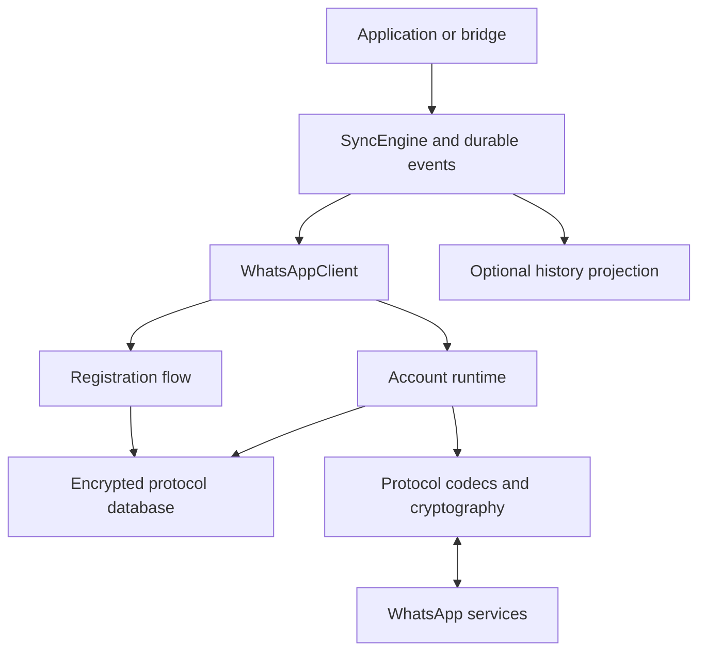

# WhatsApp Android primary-device client in Rust

Implementation plan · revised 2026-09-17

## 0. The actual objective

Build `crates/whatsapp-api`: a standalone async Rust library that registers and operates as a WhatsApp **primary device**, using a phone number the operator controls. Normal operation must require neither a paired phone nor another WhatsApp client process. Preserve the `WhatsAppClient` / `SyncEngine` / `SyncEvent` separation so the existing bridge can adopt the library through an adapter.

The long-term ambition is broad Android-client protocol coverage. The first release must make a smaller, explicit set of capabilities work reliably. “Everything the Android app does” is an eventual product ambition, not an implementable v0.1 acceptance criterion.

**First decisive result:** complete a primary registration, authenticate, exchange an encrypted text message with the official Android app, terminate the Rust process, and reconnect using only the persisted Rust-owned state. Complete this before building the full groups/media/bridge surface.

This document replaces the supplied design. It specifies engineering decisions and the evidence needed to resolve protocol-dependent decisions. It does not turn unverified protocol guesses into requirements.

### What was and was not inspected

This revision is based on the supplied excerpt and the public upstream material linked below. No repository checkout, pinned Android APK, packet captures, or account credentials were supplied. The exact existing `tzibbur-api` interfaces and encryption implementation were therefore not inspected. Compatibility with them must be established during repository reconnaissance. No WhatsApp interoperability experiment was performed while writing this plan.

### Main changes

| Original assumption | Revised decision |
| --- | --- |
| Implement the whole architecture, then discover whether registration works | Prove primary registration and a minimal encrypted round trip before expanding features |
| Use the newest official Signal library | Evaluate exact wire compatibility, state format, build dependencies, and licensing before selecting a backend |
| Reimplement every layer | Evaluate reusable Rust protocol components first; verify them against the Android profile |
| `rusqlite` satisfies pure Rust | Use `redb` for the new default store; SQLite's implementation is C |
| Selecting rustls automatically establishes pure Rust | Audit its selected cryptography provider and the complete enabled dependency graph |
| Noise static identity and Signal identity can be treated as the same key | Model separate key types and lifecycles; only implement a relationship if evidence establishes it |
| A serialized Signal record is already safe to store | Treat session/prekey/sender-key serialization as secret plaintext and encrypt it at rest |
| Session file plus independent message database is sufficient | Put ratchet mutations, minimal inbox/outbox state, and durable events in one transactional protocol database |
| `send_message` returning an ID means the message was sent | Returning a send ticket means the message is durably queued; expose subsequent delivery states |
| An in-memory callback is a reliable sync interface | Use a durable event journal, bounded delivery, replay, and explicit consumer acknowledgement |
| Primary device means only one destination device matters | Resolve recipients' devices and implement the observed per-device encryption/fanout rules |
| Media download can return an unbounded `Vec<u8>` | Stream into a bounded, integrity-verified sink |
| A server can reconstruct all old chat history | Expose observed catch-up capabilities and history gaps; do not promise unavailable history |

## 1. Scope and release boundaries

The primary-device requirement is fixed throughout all phases. QR pairing, phone-number *linking codes*, a WhatsApp Web session, and a hosted WhatsApp gateway do not satisfy primary phone-number registration.

| Capability | First proof | v0.1 release | Later coverage |
| --- | --- | --- | --- |
| Phone-number registration and supported verification steps | Required | Required | Additional server-supported flows |
| Persistent login and reconnect without fresh registration | Required | Required | Additional device/profile migrations |
| Direct text send/receive | Required | Required | Richer message types |
| Recipient device discovery and direct-message fanout | Minimum needed for proof | Required | Advanced own-companion management |
| Receipts, duplicate handling, retry/recovery | Basic observability | Required | Additional receipt classes |
| Groups: list, create, metadata, participants, text | No | Required | Communities, advanced moderation |
| Images, documents, audio, video as existing encoded files | No | Required | Optional encoding/transcoding |
| Replies, reactions, edits, revocations | No | Required for verified message forms | New forms as discovered |
| Local persistence, event replay, crash recovery | Minimum durable state | Required | Additional storage implementations |
| Profiles, contacts, presence, privacy settings | Only required bootstrap pieces | Explicit capability flags | Incremental expansion |
| Voice/video calls, payments, channels, status, backup import | No | Not advertised | Separately scoped projects |
| Telegram bridge | No | Adapter contract and integration proof | Full product integration separately |

Expose a capability matrix containing `Supported`, `Experimental`, and `Unsupported`, plus the tested protocol profile. An unsupported operation returns a typed error; it never silently reports success or drops its unsupported fields.

Do not promise calendar completion dates before the primary-device experiment. Registration acceptance and protocol drift are external dependencies, not ordinary implementation tasks.

## 2. Pure Rust means a verifiable build contract

### 2.1 Required contract

All new first-party library code, CLI code, replay tools, fixture generators, and project-specific automation are Rust. TOML, JSON, protobuf schemas, Markdown, and CI YAML are data/configuration, not additional application languages.

The shipped library and CLI must not depend on a Node, Python, Go, Java, browser, emulator, or official WhatsApp process. They must not wrap Baileys, whatsmeow, WhatsApp Web, or a hosted service as their implementation.

For this plan, interpret the dependency requirement strictly: no bundled or linked C/C++ application, storage, or cryptography implementation in the new production graph. Ordinary operating-system interfaces used through Rust's standard library and OS bindings are allowed. This is not a demand to rewrite the kernel, TLS certificate store, or Rust toolchain.

Existing external tools may be used to inspect a reference APK in the research lab. They must not become installation, build, or runtime requirements for this product. Do not add first-party foreign-language scripts to work around missing Rust functionality.

### 2.2 Storage and code generation

`rusqlite` explicitly uses SQLite's C API; its bundled feature compiles SQLite through `cc`. It is a Rust API, but does not meet the dependency contract above. Use `redb` as the initial transactional backend, behind our own store interface. `redb` describes itself as a pure-Rust ACID embedded database. [rusqlite build documentation](https://docs.rs/crate/rusqlite/0.37.0), [redb documentation](https://docs.rs/redb/latest/redb/)

Commit generated protobuf Rust code. Regenerate it with a Rust `xtask` using `protox` and `prost-build::compile_fds`, keeping their descriptor types on compatible versions. Normal consumers must not need `protoc`, a C++ compiler, network downloads, or code generation during `cargo build`. This removes the proposed default `build.rs`. [protox documentation](https://docs.rs/protox/latest/protox/)

Audit upstream build scripts too: checking in our generated code does not remove a transitive dependency's `protoc` requirement.

### 2.3 TLS is an explicit dependency gate

rustls separates TLS from its cryptographic provider. A Rust HTTP client using rustls does not, by itself, prove that all its cryptography is Rust. Pin and inspect the provider actually selected by the chosen rustls/HTTP versions. Do not copy feature names between rustls versions. [rustls provider documentation](https://github.com/rustls/rustls#cryptography-providers)

The reviewed `rustls-rustcrypto` documentation describes a pure-Rust provider but currently warns against production use. It is a research candidate, **not an automatically approved production dependency**. Establish compatibility, security maturity, supported algorithms, and maintenance before relying on it. [rustls-rustcrypto documentation](https://docs.rs/rustls-rustcrypto/latest/rustls_rustcrypto/)

Graviola is a separate candidate if the project later chooses to allow Rust plus included assembly: its own documentation says it includes assembly and has architecture/CPU restrictions. “No C compiler required” is not the same as an entirely Rust cryptography implementation. Under the strict contract in this plan, do not silently select it. [Graviola documentation](https://github.com/ctz/graviola)

**Decision rule:** select an adequately reviewed pure-Rust provider that works with the chosen HTTP stack. If none qualifies, mark production HTTPS support blocked and document the exact deficiency. Offline work may continue. Do not weaken certificate validation, implement a new TLS stack, or quietly relax the language requirement to clear this gate. An experimental build must remain explicitly experimental.

### 2.4 Prove the dependency graph

For each supported release target and feature set:

1. Inspect `cargo metadata` and `cargo tree -e features` for normal, build, and development dependencies relevant to that job.
2. Audit build scripts and native linking. A crate name ending in `-sys` is a review signal, not a complete detection algorithm.
3. Reject unapproved native crypto/storage, subprocess runtimes, and code-generation downloads.
4. Include the eventual WhatsApp-enabled bridge executable in the audit before calling that executable pure Rust.
5. Keep an auditable dependency report with exact versions/revisions and enabled features.

Do not migrate unrelated `tzibbur-api` internals merely to make this new crate. Report any existing workspace dependency that prevents the intended final executable from meeting the contract.

## 3. Reuse protocol work without importing the wrong product

There is an existing Rust project, `oxidezap/whatsapp-rust`, whose documented structure includes a binary codec, Signal implementation, app-state logic, and protobuf definitions. Its documented authentication is QR/pair-code linking for the WhatsApp Web API. Those facts make it a candidate source of reusable components, not proof of Android primary-device support. [whatsapp-rust repository](https://github.com/oxidezap/whatsapp-rust)

Before writing a new binary codec or Signal state machine, evaluate that project's relevant Rust modules at a pinned revision. For each proposed reuse, record:

- Component boundaries and whether it can run without the parent client's linked-device login.
- Android-profile fixture compatibility, rather than just web-client compatibility.
- State-store integration, error handling, resource limits, and test coverage.
- Complete source provenance and file-level licensing, including inherited code.
- Rust-only build compliance and maintenance cost.
- Whether a registry release can depend on it, or whether a maintained vendored component is necessary.

Prefer a small, reviewed reusable component over a full-client fork. Keep any fork's patch set explicit. Do not make production builds fetch a floating branch.

The official Signal repository states that use outside Signal is unsupported and its APIs can change without notice. Its Rust protocol package exists in the repository, but that does not establish a supported crates.io dependency or WhatsApp compatibility. The current manifest also includes post-quantum components. Pinning “latest libsignal” is therefore not a compatibility strategy. [Signal repository](https://github.com/signalapp/libsignal), [protocol package manifest](https://github.com/signalapp/libsignal/blob/main/rust/protocol/Cargo.toml)

Select a Signal backend only after the interoperability gate in section 10. Preserve all applicable license notices; a repository's headline license does not resolve every imported file's provenance.

## 4. Order of execution and acceptance gates

| Gate | Work | Evidence required to pass |
| --- | --- | --- |
| G0 — Repository and dependencies | Inspect local instructions and existing crate APIs; choose initial target; evaluate Rust components, storage, TLS, Signal candidates | Repository map, dependency decision records, current build baseline, explicit unresolved blockers |
| G1 — Minimal protocol evidence | Pin Android reference and build only enough registration, framing, nodes, and crypto to attempt one conversation | Hashed reference manifest, fixture provenance, minimal working replay harness; no invented wire constants |
| G2 — Primary-device proof | Register one controlled test number, authenticate, exchange encrypted direct text, stop and restart | Official peer receives and sends valid messages; Rust reconnects from its own state without QR, companion app, or fresh OTP |
| G3 — Durable messaging | Implement transactional crypto state, outbox/inbox, event replay, receipt handling, disconnect/reconnect and resource limits | Crash matrix and replay tests pass; ambiguous delivery is represented honestly |
| G4 — Devices and groups | Complete recipient device lifecycle, sender-key distribution, group operations and membership changes | Verified behavior with multiple recipient devices and group membership changes |
| G5 — Media and message operations | Streaming media upload/download; replies, reactions, edits, revocations, expiry handling | Official-client round trips and adversarial integrity/resource-limit tests |
| G6 — Integration and release | Bridge adapter, documentation, packaging, feature/target checks, operational runbook | Standalone crate packages cleanly; advertised capabilities have evidence; bridge consumes/replays events correctly |

G2 is a **vertical slice**, not a requirement to finish every lower layer first. Implement the minimum real pieces needed to make it decisive. An authenticated socket alone does not pass G2. A message exchanged using imported linked-device credentials does not pass it either.

G0's production TLS gate may remain unresolved during offline work or a labeled experimental lab spike. It must be resolved before production readiness is claimed.

If primary registration is blocked, produce a concrete blocker report containing the request stage, sanitized response class, reference profile, attempted supported flow, and evidence still needed. Keep offline codec/store work useful. Do not rename a linked-device implementation to make the milestone appear complete.

## 5. Repository layout

Keep one primary library crate. Split internal modules as they acquire real behavior; do not generate empty modules for every future feature.

| Path | Responsibility |
| --- | --- |
| `crates/whatsapp-api/Cargo.toml` | Library manifest and intentional feature selection |
| `src/lib.rs`, `src/client.rs`, `src/error.rs` | Public facade, lifecycle, typed errors |
| `src/model/` | Account/contact/device/chat identifiers, messages, receipts, capabilities |
| `src/profile.rs` | Validated protocol profile, reference version and compatibility information |
| `src/registration/` | Bootstrap state machine, HTTPS requests, challenges, durable attempt state |
| `src/transport/` | Byte-stream framing, Noise adapter, certificate verification, connection epochs |
| `src/binary/` | Nodes, bounded decoder/encoder, profile-specific tokens and JID encodings |
| `src/proto/`, `proto/` | Generated Rust and source schemas with provenance |
| `src/signal/` | Backend adapter, peer identities, sessions, prekeys, sender keys |
| `src/runtime/` | Account actor, stanza routing, bounded queues, request correlation, shutdown |
| `src/store/` | Transaction contract, `redb` backend, encrypted envelopes, migrations |
| `src/session.rs` | Credential lifecycle, key-source boundary, export/restore policy |
| `src/outbox.rs`, `src/inbox.rs` | Durable send attempts, inbound deduplication and processing |
| `src/sync.rs`, `src/reconcile.rs` | Durable events, local projections, observed catch-up behavior |
| `src/devices.rs`, `src/groups.rs`, `src/media.rs` | Feature-specific protocol operations |
| `tests/fixtures/`, `tests/` | Sanitized fixtures, negative cases, crash/replay/integration tests |
| `crates/whatsapp-cli/` | Rust operator tool and minimal standalone proof client |
| `xtask/` | Rust schema generation, replay, dependency inspection and stress tools |
| `docs/protocol/`, `docs/adr/` | Evidence, unknowns, backend decisions and compatibility matrix |

The library must not depend on `crates/bridge` or `crates/tzibbur-api`. Inspect those crates for integration patterns; do not import application-specific errors, Telegram IDs, or session-file assumptions into the protocol library.

Use public library error names such as `Error` / `WhatsAppError`, not an application's `AppError`.

## 6. Evidence is part of the implementation

### 6.1 Pin the reference and record server observations

Maintain a machine-readable reference manifest containing:

- Android application package, version name/code, release source, signing-certificate fingerprint, and APK/split hashes.
- Research device OS/architecture and relevant configuration, without real account identifiers.
- Observation date and whether the server accepted the reference client during that observation.
- Relevant Rust/reference implementation revisions.
- Token dictionary hash, schema hash, supported framing/profile identifiers, and associated test fixtures.

A pinned APK is authoritative for that client's behavior. It is **not** proof that the current server still accepts that behavior. Track client findings and dated live-server observations separately.

Use four evidence labels: `Observed`, `Derived`, `ReferenceOnly`, `Unknown`. Every important wire constant must point to evidence. A known-good third-party web implementation starts as `ReferenceOnly` for the Android primary profile.

### 6.2 Findings needed for the first proof

| Area | Questions to resolve |
| --- | --- |
| Registration | Endpoints, payload encoding, prerequisites, key-generation timing, verification steps, account challenges, returned credential material |
| Login | Client payload, primary-device markers, version fields, required startup requests, resume behavior |
| Transport | Endpoints, direct stream versus WebSocket, any TLS layer, preamble, frame lengths, compression, maximum records |
| Noise | Pattern, algorithms, prologue, handshake payloads, trust anchors, certificate encoding and static-key binding |
| Binary nodes | Token pages, packed strings, JID encodings, duplicate attributes, empty/content representations |
| E2EE | Session/message versions, key encodings, signatures, prekey upload/fetch, padding/wrappers, retry semantics |
| Devices | Address types, device-list discovery and invalidation, own/remote device distinctions |
| Messaging | ID format, message envelope, receipt/ACK classes, request correlation and error stanzas |

OTP receipt by itself proves neither registration nor authenticated messaging.

### 6.3 Fixtures

Fixtures must include independent known-good examples, not just bytes produced by our own encoder. Test decoding against expected semantics and encoding against independently established valid forms. Do not require byte-for-byte equality where multiple encodings are valid unless the profile requires canonicalization.

Keep real keys, phone numbers, message contents, OTPs, registration responses, and capture secrets out of committed artifacts. Sanitization must preserve or regenerate authentication consistently; changing bytes inside an authenticated capture generally invalidates it. Use synthetic test identities for redistributable cryptographic vectors. Keep any necessary private lab evidence separate.

## 7. Registration is its own durable state machine

Treat registration as a potentially branching protocol, not a universal two-call `request_otp` / `verify_otp` flow.

| State | Meaning and allowed behavior |
| --- | --- |
| `Unregistered` | No established account credentials |
| `Preparing` | Create and persist the exact prerequisites required by this profile |
| `ChallengePending` | Verification requested; record method, expiry, attempt identity and retry deadline |
| `NeedsUserAction` | A supported additional step is required, such as a PIN or another server-directed verification action |
| `Verifying` | A submitted answer is in progress; prevent concurrent conflicting attempts |
| `RegistrationOutcomeUnknown` | Request outcome was lost; reconcile using an observed safe flow before repeating mutations |
| `Registered` | Server-issued state and required identity material have been durably committed |
| `CoolingDown` | Observe the server's retry timing |
| `Blocked` | This profile cannot complete the required step, or the server refuses the flow |

Generate identity/prekey/device material **before whichever request first requires it**, and persist it before transmitting that request. Do not retain the original diagram's assumption that key generation necessarily follows OTP verification.

A challenge handle is opaque and bound to the account, phone number, protocol profile, registration attempt and generation. An old challenge cannot be answered for a new attempt. Support sequential challenge steps without exposing reusable secrets through `Debug` or ordinary serialization.

Required behavior:

- Validate and normalize the phone number with explicit country information; preserve the protocol's required representation.
- Separate an account registration ID, local account ID, wire message ID, device ID and challenge ID.
- Keep Noise static keys and Signal identity keys as distinct typed values.
- Persist only credentials actually observed. Do not invent a bearer token, cookie, password or fingerprint field because another API uses it.
- Honor expiry and retry constraints; do not loop through OTP requests or verification attempts.
- Do not log or durably store OTPs or user-entered PINs as ordinary state.
- Return typed required actions or a specific unsupported-registration error for unimplemented server requirements.
- Never re-register automatically to repair an expired connection, a malformed stanza, or an unknown login failure.
- Registration, logout/revocation, disconnect and local deletion are different operations.

Use controlled test numbers for live experiments. The acceptance test must show that registration succeeds on the intended supported path without importing another client's completed session. Owning a number does not imply that the server will accept a custom client.

## 8. Runtime and protocol architecture



### 8.1 One owner per account

Start with one account actor owning mutable protocol state. Cloning `WhatsAppClient` clones a handle to that actor, not a connection or a second cryptographic session.

Use bounded command/event channels, an explicit cancellation token, and owned task handles. Separate socket I/O and blocking database work from the actor. No database guard or application mutex may remain held across unrelated network awaits.

Use a single process owner for each account database. Reject a second writer; do not build distributed leases or active-active session sharing for v0.1. Two machines with copied credentials must not be treated as supported concurrent owners.

Every connection has a new local epoch. Tag outstanding requests, reader/writer completions and reconnect tasks with it. A delayed response from an old socket must not complete a new request.

Implement bounded request correlation with expected response type, deadline, cancellation and disconnect behavior. Route unsolicited notifications separately from IQ/request responses.

### 8.2 Keep the layers separate

| Layer | Responsibility |
| --- | --- |
| Public domain API | Typed commands, status, capabilities and results |
| Behavior | Durable sends, device/group state, receipts, retries, media and reconciliation |
| E2EE and message models | Signal sessions/sender keys and the observed encrypted payload/wrapper formats |
| Binary nodes | Envelope descriptions, attributes, JIDs and child/content encoding |
| Transport security | Exact Noise handshake, certificate validation and record encryption |
| Framing and I/O | Observed preamble/length/compression rules and byte-stream boundaries |
| HTTPS operations | Registration and media/bootstrap operations that actually use HTTP |

Protobuf is used where the observed protocol uses it: potentially handshake payloads, certificates and encrypted message bodies. It is not a single mandatory wrapper around every operation. `WebMessageInfo` must not become the default Android wire payload merely because a reference library exposes it.

### 8.3 Noise is a compatibility decision

`Noise_XX_25519_AESGCM_SHA256` remains a hypothesis until confirmed for the profile. Noise does not inherently negotiate a cipher suite like TLS; do not describe a fixed observed suite as negotiated without evidence.

Verify pattern, prologue/preamble, payload placement, key roles, certificate encoding, trust roots, and the binding between the validated certificate and the remote static key. A successful Noise transcript alone does not validate an application-specific server certificate. Do not use an accept-all certificate callback.

Evaluate `snow` with its Rust crypto resolver. Its documented transport API rejects records exceeding 65,535 bytes, so verify observed WhatsApp record sizes before committing to it. Do not arbitrarily fragment WhatsApp records to fit a library; that would change the wire protocol. If needed, evaluate a reviewed existing Rust WhatsApp transport implementation or a narrowly justified backend change. [snow crypto documentation](https://docs.rs/snow/latest/snow/), [snow transport limits](https://docs.rs/snow/latest/snow/struct.TransportState.html)

Delegate AEAD/counter mechanics to the accepted transport backend. Maintain distinct send/receive state and ordered writes. After a partial write, ambiguous cancellation, authentication failure or socket loss, close that connection rather than guessing whether its counters can be reused. A reconnect performs a fresh handshake; never restore old Noise transport keys/counters to a new socket.

### 8.4 Framing and decoder boundaries

Read from a byte stream, not assumed packet boundaries. Handle fragmented headers/bodies and multiple frames in one read. Preserve partial bytes across cancellation, or tear down the entire connection on cancellation. A casual `select!` around a consuming `read_exact` is not a sufficient framing strategy.

Bound length prefixes before allocation. Bound decompressed output, nesting depth, attribute count, child count, strings, protobuf payloads and outstanding requests. Test decompression bombs and integer overflow.

An illustrative in-memory node shape is:

```rust
pub struct Node {
    pub description: NodeName,
    pub attributes: Vec<Attribute>,
    pub content: NodeContent,
}

pub enum NodeContent {
    Empty,
    Bytes(bytes::Bytes),
    Children(Vec<Node>),
}
```

This is a design sketch; `NodeName` and `Attribute` require concrete definitions. Preserve the original structure where useful, but support validated typed JIDs and any observed non-string encoding. Never decode malformed bytes through lossy UTF-8 conversion. Define duplicate-attribute handling explicitly, especially for security-sensitive fields.

Unknown *semantic* fields may be retained as opaque data. An unknown token that prevents structural decoding is a protocol-compatibility error, not an invitation to guess the remaining frame.

## 9. Domain model, addresses and device identity

Use newtypes for `AccountId`, `AccountGeneration`, `ChatId`, `ContactId`, `DeviceAddress`, `MessageId`, `ClientRequestId`, `EventId` and `EventCursor`. Avoid APIs where all of these are interchangeable strings.

A contact identifier is not automatically a phone number, and a cryptographic session belongs to an addressed device, not just a human-readable contact. Preserve observed phone-number JIDs, logical IDs, device suffixes and group IDs as distinct representations. Resolve aliases only from authenticated protocol evidence. Never merge identities based on display name or guessed number equality.

Meta's published multi-device architecture describes per-device identity keys, device discovery, direct-message fanout and group sender keys. This is useful architectural evidence, not a current Android wire specification. Our design consequence is that “we are primary” does not eliminate recipient device handling. [Meta multi-device architecture](https://engineering.fb.com/2021/07/14/security/whatsapp-multi-device/)

Required device behavior:

- Fetch and cache authenticated device lists with an explicit version/expiry policy.
- Invalidate them on observed device-change notifications and applicable server errors.
- Key sessions and peer identity decisions by full device address and account generation.
- Handle device additions/removals and races between preparation and transmission.
- Implement recipient fanout and any required own-device copies from evidence.
- Keep own-companion enrollment a separate capability; do not pair a phone to satisfy initial registration.

Use composite logical message keys including local account generation, chat and sender/direction components as required by the protocol. Do not assume message IDs are globally unique.

Represent message content as a tagged domain enum, including an explicit `Unsupported` form. Keep raw bounded payloads where needed for later decoding; do not assume a protobuf decode/re-encode preserves unknown fields byte for byte.

Edits, reactions and revocations refer to an original message identity. They must not create unrelated messages because the original is absent locally. Persist pending mutations/tombstones and reconcile when the referenced message arrives. Preserve server timestamps separately from local observation time.

## 10. Signal and sender-key integration

### 10.1 Backend selection gate

Place all backend-specific APIs and serialization behind `src/signal/`. The public library must expose neither backend protobuf types nor backend storage traits.

Compare the reusable Rust WhatsApp implementation and a compatible pinned official Signal revision. Do not assume newer Signal client features are required or accepted by WhatsApp. Do not downgrade a library merely until it stops rejecting inputs; establish the actual expected version and its security properties.

The backend must pass independently established vectors for:

1. Identity and signed-prekey encodings/signatures, registration ID ranges and one-time prekey handling.
2. Initiator/responder session setup and the actual prekey/message envelope variants.
3. Bidirectional ratchet advancement, out-of-order messages, skipped-message limits and duplicate rejection.
4. Persist/reload of all relevant session forms.
5. Sender-key distribution, group encryption/decryption, sender devices and key rotation.
6. Authentication failures, invalid signatures, identity replacement, exhausted/missing prekeys and malformed records.
7. Interoperability with the pinned Android app, beyond backend-to-itself round trips.

Do not implement cryptographic primitives from scratch. If no candidate passes, document the incompatibility and scope a specific compatibility adapter or maintained fork. Do not hide wire incompatibility behind a generic trait and declare the integration complete.

### 10.2 Secret state and trust

Signal session records include material needed to continue encryption/decryption. Their serialization is **not storage encryption**. The same applies to prekey and sender-key records. Encrypt every secret-bearing record before it reaches the database.

Store peer identity decisions as well as our own identity. First-contact trust and subsequent identity changes are distinct events. Define an explicit default policy: accept an initial identity according to the verified protocol trust model; on an unexpected replacement, emit `IdentityChanged` and suspend affected sends until the configured policy resolves it. Do not silently overwrite trusted keys on every fetch.

Persist prekeys before upload, record ambiguous upload outcomes, and reconcile without losing private keys. Use `(kind, id)` keys so signed and one-time identifiers cannot collide. Retain old signed prekeys for an observed grace period; do not delete them immediately upon rotation. One-time prekey consumption must commit atomically with the inbound session mutation it enables.

### 10.3 Sender keys

Index sender-key records by group, full sender-device identity and the observed distribution/key identifier. A group ID plus human contact ID is insufficient.

Track which participant devices need the current sender-key distribution. Distribute through the required pairwise encrypted channels before or with group traffic according to the observed protocol. Handle membership changes, removed devices, stale metadata, retries and out-of-order distribution messages. Do not assume the server distributes sender keys for us.

The account actor serializes crypto operations in v0.1. Optimize concurrency only after proving ordering and transactional correctness; two concurrent sends must never both consume the same pre-mutation session snapshot.

## 11. Persistence: one atomic protocol state, optional separate history

### 11.1 Database boundaries

Use one protocol database per account, initially `protocol.redb`. It stores everything whose consistency affects future communication: credentials, crypto state, minimal pending messages, retry state, durable events and checkpoints.

Optional searchable history belongs in a separate `history.redb` or a caller-supplied projection. The library's correctness must not depend on that projection being current.

This deliberately changes the original key-only database rule. A minimal inbox/outbox journal belongs with the ratchets because the send/decrypt operation must commit atomically. Completed historical conversation storage can remain separate. A key-only backup cannot safely claim to restore pending protocol work.

### 11.2 Logical schema

These are logical tables, not SQL DDL. Prefix all records with account generation where applicable. Version both the database schema and individual record formats.

| Table | Key | Value |
| --- | --- | --- |
| `meta` | Metadata name | Schema version, profile ID, account generation, journal counters |
| `account` | Singleton | Our identities, Noise static material, registration state and observed credentials |
| `registration_attempts` | Attempt ID | Durable state, challenge metadata, generation, deadlines and outcome |
| `prekeys` | `(kind, prekey_id)` | Secret record, publication/consumption state and version |
| `peer_identities` | Full device address | Identity material, trust decision and change history |
| `signal_sessions` | Full device address | Encrypted serialized session and revision |
| `sender_keys` | `(group, sender_device, distribution_id)` | Encrypted sender-key record and revision |
| `device_lists` | Contact identity | Device set, evidence/version and refresh state |
| `groups` | Group ID | Metadata, membership revision and pending mutations |
| `sender_key_distribution` | `(group, key_generation, recipient_device)` | Pending/observed distribution state |
| `inbox` | Protocol deduplication key | Pending/processed marker, bounded payload, receipt obligations |
| `outbox` | Local message ID | Request identity, durable intent, prepared attempts and delivery facts |
| `idempotency` | `(caller_namespace, client_request_id)` | Local message ID and semantic request hash |
| `events` | Monotonic cursor | Stable event ID, kind, revision and encrypted payload |
| `consumers` | Consumer ID | Last contiguous acknowledged cursor and retention policy |
| `checkpoints` | Observed stream/sync namespace | Catch-up cursor/version if the protocol actually provides one |
| `media_jobs` | Job ID | Encrypted references, staging state, digests and resume metadata |

The same protocol-store transaction must support atomic updates to any necessary combination of these tables. A store abstraction exposing only independent `put_session` and `put_message` calls is insufficient.

### 11.3 At-rest encryption

Use RustCrypto `XChaCha20Poly1305` for new at-rest envelopes, with an independently generated 24-byte random nonce for each write. Its larger nonce space avoids a fragile application-managed persistent counter across crashes and backups. This is a storage format choice; it does not alter WhatsApp's wire cryptography. Fail on entropy-source failure; never substitute a timestamp, row ID or deterministic test RNG in production. [RustCrypto algorithm documentation](https://docs.rs/chacha20poly1305/latest/chacha20poly1305/)

Envelope fields: format version, algorithm identifier, key ID, nonce, ciphertext and authentication tag. Authenticate the account generation, table/record identity and format version as associated data using an unambiguous length-delimited encoding. Substituting a valid ciphertext into another row must fail.

Keep the master key outside the database. Accept an injected `KeySource`; let the CLI obtain it from an operator-selected secret source, with an environment variable as an explicitly supported option. Validate the key encoding/length. Never generate a replacement key when an existing store cannot decrypt.

Use a wrapped per-database data key and a separately domain-separated index key where needed. Sensitive lookup identifiers can use keyed indexes; their reversible mappings remain encrypted. Encrypt message journal bodies, media keys, auth state and device fingerprint data too. Table sizes, record counts and some structural metadata will remain visible: this is record encryption, not whole-file confidentiality.

Wrong key, corrupted tag, unsupported envelope version and missing key ID are typed failures. Implement key rotation as a restartable migration with old-key retention until all referenced records/backups are addressed. Use redacted diagnostics and zeroizing secret containers; do not claim memory erasure from every allocator copy.

The existing `AesGcmCipher` pattern may inform the `KeySource` and envelope boundary after inspection. Do not share a nontransactional `FileSessionStore` as a second live source of ratchet state. If importing an existing encrypted format is needed, make it an explicit migration, not a plaintext fallback.

### 11.4 Async/transaction boundary

`redb` persistence is blocking; run database operations on a dedicated worker or bounded blocking executor. The account actor owns the operation order.

For an async Signal backend, load an owned, versioned snapshot of required records and use an in-memory transaction overlay. The adapter reads/writes that overlay. Commit the resulting mutations and message/event records atomically with expected-revision checks. Never retain database guards across asynchronous crypto callbacks or network I/O. On conflict, discard the derived output and reload; never transmit ciphertext derived from an uncommitted stale snapshot.

Use durable commit settings for cryptographic advancement. If a commit reports an ambiguous I/O failure, stop further protocol mutation until reopening/recovery determines what committed. Do not keep running with a potentially divergent in-memory state.

### 11.5 Backups and rollback

Back up a consistent protocol snapshot, including pending inbox/outbox and crypto state. Exclude optional historical projections if desired. Do not copy live database files outside the backend's supported snapshot/backup procedure.

Restoring an old valid encrypted snapshot is not the same as recovering the latest ratchet state. AEAD detects tampering, not rollback. Fence off the old running owner, preserve the restored generation, and use only a verified recovery procedure. If safe recovery is unavailable, return a recovery-required condition; do not force old state into service or automatically re-register.

Never resume old Noise transport counters after restore. Preserve idempotency mappings and message IDs where recovery supports retry. State exactly what a backup can and cannot recover.

## 12. Outbox: commit encryption state before transmission

### 12.1 API guarantee

`send_message` durably accepts an intent and returns a `SendTicket`. It does not claim server acceptance, recipient delivery, or reading.

Require a caller-supplied `ClientRequestId` for callers that need retry-safe enqueue. An identical repeated request returns the same ticket; reuse of the ID with different semantic content returns `IdempotencyConflict`. Generate the WhatsApp wire ID using the observed format and persist it before transmission. UUIDs may be local IDs; they are not automatically valid wire IDs.

### 12.2 Send sequence

1. Validate capability, limits and the request identity; commit the immutable intent to the outbox.
2. Resolve recipients/devices and required trust/group state. Network discovery happens outside a database transaction.
3. Load the relevant versioned crypto snapshot and prepare the E2EE payloads in the transaction overlay.
4. Atomically commit updated crypto state, the full prepared E2EE attempt, destination snapshot, wire identity and status/event changes.
5. Only after that durable commit, encode the envelope and send it through the current Noise connection.
6. Persist validated ACKs, receipts, protocol retry requests and terminal errors as new facts.

For multi-device sends, the committed attempt must contain the full intended fanout and all associated state mutations, or explicitly model staged sub-attempts. A half-prepared send cannot disappear from recovery.

Persist **E2EE payloads and necessary stanza data**, not old Noise ciphertext. Retransmission on a new connection requires new transport encryption.

Distinguish two cases:

- A network retry of the same committed attempt reuses its persisted E2EE payload and message identity when the observed protocol allows it.
- A protocol-directed re-encryption/session-repair attempt is a new durable attempt under the same logical message, with its own validated crypto mutations. Never re-encrypt blindly on every timeout.

An existing prepared group attempt must be reconsidered when membership changes. Do not blindly resend distribution material to a removed member. Follow the verified protocol's retry/update rules or return an explicit unresolved outcome.

### 12.3 Honest outcomes

Separate attempt progress (`Queued`, `Prepared`, `InFlight`, `RetryScheduled`) from delivery facts (`ServerAccepted`, recipient/device receipts, `Failed`, `DeliveryUnknown`). Receipt ordering may differ from ACK ordering. Maintain per-recipient/device facts before deriving a user-facing aggregate.

Exactly-once delivery over an unreliable external network is not promised. After a lost response, local state may not prove whether the server accepted an operation. Preserve the ambiguity rather than generating a second logical message with a new ID.

Cancellation before transmission can stop a queued intent. Cancellation after transmission cannot unsend it; that requires a separately supported revocation operation. Dropping a Rust future after enqueue must not erase the durable send.

## 13. Inbox, receipts and durable events

### 13.1 Inbound sequence

1. Validate transport authentication, structural bounds, envelope routing and addressing.
2. Determine the protocol deduplication identity. A processed duplicate follows the appropriate ACK/receipt behavior without ratcheting or re-emitting a new logical message. Distinguish a legitimate protocol retry/re-encryption from conflicting content under the same identity; do not silently overwrite an existing message or trust an ID collision as proof of equivalence.
3. Persist a minimal recoverable inbound envelope if the protocol requires an early transport acknowledgement.
4. Decrypt using a versioned crypto snapshot/overlay; validate the message content and any authenticated control operation.
5. Atomically commit crypto mutations, prekey consumption, processed identity, normalized event and required receipt work.
6. Fulfill application-level delivery receipts after durable processing, according to observed semantics.

Not all acknowledgements mean “message decrypted and delivered.” Identify transport ACK, delivery receipt, read receipt and played receipt separately. If an ACK must precede successful decryption, first durably store enough material to resume processing. Do not globally delay time-sensitive protocol ACKs based on an invented rule.

If decryption fails or a backend partially mutates its overlay before returning an error, discard those changes unless the backend contract explicitly requires a specific recovery mutation. Persist a bounded retry/quarantine state, not a successful user message.

Do not acknowledge a message as read merely because it was stored, emitted to a callback, or forwarded to a bridge. Read/played receipts are explicit application policy.

### 13.2 Journal and replay

Each committed domain event has a stable `EventId`, monotonically ordered per-account cursor, account generation and entity revision where relevant. Consumers request bounded batches after a cursor and acknowledge contiguous progress.

Deliver at least once. Consumers deduplicate by event identity and make their own local effects transactional. Waking a subscriber may use an in-memory channel; the database remains the source of truth if a notification is dropped.

A slow consumer must never cause silent loss. Apply configured disk/queue limits, pause work where the protocol permits, and expose backpressure. Retention may expire an abandoned consumer only under an explicit policy; later reads return `CursorExpired` with recovery information, not a false empty batch.

Project history in its own transaction, then acknowledge the source cursor. A crash between these operations causes replay, which the projection must handle idempotently. Do not attempt an implicit distributed transaction between protocol and history stores.

### 13.3 Sync is not necessarily a server history API

`SyncEngine` consumes the protocol journal, manages local projections and performs only catch-up operations actually supported by the primary profile. It does not run a second connection reader.

Do not import linked-device history/app-state assumptions wholesale. Primary startup, offline queues, group metadata synchronization and companion history transfer can have different responsibilities.

Define `sync_once` as a bounded catch-up/drain with a cursor and progress report. It cannot promise “all history downloaded” without an observed API that provides it. Return a `HistoryGap` or unsupported-capability result where recovery is unavailable.

## 14. Public API contract

Keep a cloneable `WhatsAppClient` handle and a separate `SyncEngine`. Exact Rust signatures must be adapted to the inspected workspace conventions; the following behavioral contract is mandatory.

| Operation | Required behavior |
| --- | --- |
| `WhatsAppClient::builder()` | Accept validated profile, account store, key source, HTTP backend, limits and policies; no implicit registration |
| `registration().begin(...)` | Start/resume a durable primary-registration attempt and return its current step |
| `registration().submit(...)` | Submit a typed answer for a specific step; return next step or completed registration |
| `connect()` | Idempotently start one runtime and wait for authenticated readiness, with timeout/cancellation |
| `connection_state()` | Watch current status, reason and connection epoch; no durable-message guarantee implied |
| `disconnect()` | Stop reconnecting, shut down owned tasks and preserve resumable state; no account logout |
| `send_message(SendRequest)` | Durably enqueue and return a stable `SendTicket` |
| `message_status(ticket)` | Retrieve current aggregate and per-recipient delivery facts |
| `send_receipt(Receipt)` | Queue an explicit valid receipt under configured privacy policy |
| `groups(PageRequest)` | Return a bounded page and continuation, not an unbounded list |
| `create_group(CreateGroupRequest)` | Track request identity and ambiguous outcomes; do not blindly recreate on timeout |
| `upload_media(source, options)` | Bounded staged upload of caller-provided encoded content |
| `download_media(reference, sink)` | Enforce limits and release only verified content to the final sink |
| `events(consumer, cursor, limits)` | Replay durable domain events with explicit acknowledgement |
| `capabilities()` | Return support levels and tested profile information |

`request_otp` and `verify_otp` may remain convenience methods for a profile's supported SMS flow. They must delegate to the registration state machine and surface additional steps rather than pretending every flow ends after OTP submission.

A compatible event model must cover:

```rust
// API sketch: associated domain types are defined in src/model/.
pub struct EventEnvelope {
    pub account_id: AccountId,
    pub account_generation: AccountGeneration,
    pub event_id: EventId,
    pub cursor: EventCursor,
    pub event: SyncEvent,
}

#[non_exhaustive]
pub enum SyncEvent {
    NewMessage(Message),
    MessageUpdated(MessageUpdate),
    MessageDeleted(MessageKey),
    ReceiptUpdated(Receipt),
    SendStatusChanged(SendStatusUpdate),
    GroupCreated(Group),
    GroupUpdated(GroupUpdate),
    IdentityChanged(IdentityChange),
    HistoryGap(HistoryGap),
    UnsupportedMessage(UnsupportedMessage),
    SessionRevoked(RevocationReason),
}
```

Use a separate live connection-state watch for `Connecting`, `Ready`, `Backoff`, `Disconnected`, `NeedsRegistration`, `Revoked` and `Stopped`. If the existing bridge expects connection changes inside `SyncEvent`, map them in its compatibility adapter with clear live-event semantics.

An old callback interface may be an adapter over durable events. Prefer an async fallible handler or explicit batch acknowledgement; a synchronous `Fn(SyncEvent)` cannot establish that a consumer durably processed an event.

Typed errors must distinguish invalid input, unsupported capability/profile, registration action required, rate limit with deadline, authentication failure, revoked session, identity change, invalid certificate, malformed protocol, storage failure, wrong storage key, exhausted resources and uncertain delivery. Preserve useful sanitized server codes without leaking payloads.

Reconnect only for classified recoverable failures, with jittered capped backoff. A revoked account, invalid certificate, corrupted store, required registration action or incompatible profile must not enter an endless reconnect loop.

## 15. Groups and message operations

Create groups and change membership through durable operation records. Group creation is a non-idempotent server action unless evidence proves otherwise. After a lost response, reconcile through an observed request/group identity or report an uncertain outcome; do not create duplicate groups automatically.

Before sensitive group actions, validate the latest known membership/admin state. Treat server results as authoritative and update local state transactionally. Handle pagination and large memberships without unbounded allocation.

For group notifications, verify the available authenticated sender/context and revision semantics. Deduplicate them and tolerate out-of-order arrival. Reconcile stale membership before distributing new sender keys.

Replies preserve the original chat/message/sender reference. Reactions track add/change/remove semantics. Edits and revocations validate the acting identity and reference; they must not mutate another sender's message merely because a supplied ID matches. Separate local deletion from a protocol request to delete for others.

Preserve disappearing-message timers and view-once indicators in the domain model. Apply verified expiry rules to local bodies and media, while retaining only the minimal bounded tombstones required for correctness. Do not invent ordinary downloadable content when a message type is unsupported. Bridge support for these features requires a separate capability decision.

## 16. Media without hidden native dependencies

Media references carry more than a URL: retain the observed encryption key material, hashes/MAC information, length, type, expiry/reupload information and any required binding to the message. Encrypt these references at rest and redact signed URLs and keys in logs.

Implement exactly the observed media construction. It may differ from both Noise encryption and at-rest encryption. Add RustCrypto AES/CBC/HMAC/HKDF components only if verified wire behavior needs them. Do not replace a legacy media cipher construction with a preferred modern cipher and expect interoperability.

Use streaming I/O with configurable byte/time/concurrency limits. Never trust `Content-Length` as the only limit. Hash and authenticate what was actually read.

When full-message authentication is required, stage encrypted content to a bounded temporary file, verify it, and only then expose plaintext through a final destination. If partial plaintext staging is unavoidable, use protected staging and do not publish it before final verification. Failed/cancelled downloads clean up staging state.

For uploads, generate and persist per-media secrets and resumable job metadata before the dependent message send. Verify the completed upload response before constructing a sendable reference. Handle expired URLs/reupload only through observed supported flows.

Apply a dedicated media HTTP policy: validated HTTPS, constrained redirects, no forwarding of registration/auth headers to arbitrary hosts, and rejection of loopback/private/link-local destinations unless explicitly required by a local test configuration. Treat remote filenames as labels, never filesystem paths.

Accept already-encoded image/audio/video/document bytes in v0.1. No FFmpeg, native codecs, ImageMagick, or shell subprocesses. Generate optional thumbnails only using reviewed Rust libraries; clearly report unavailable optional previews. File transport does not require implementing a video encoder.

## 17. Bridge compatibility without coupling the library to Telegram

Inspect the existing bridge before selecting adapter names. Preserve its high-level sync/event pattern, but add the durability and capability information it actually needs. Use a small adapter over the two real implementations; do not introduce a speculative universal messaging framework.

The adapter must preserve source account/chat/message identity, source revision, event ID, reply relationships and outgoing client request IDs. Persist destination mappings and pending forwarding work transactionally in the bridge's own store, then acknowledge the library event. Prevent loops by origin identity, not by comparing message text.

Use source events to create destination work; do not make Telegram network calls from the WhatsApp socket reader. Handle rate limits, partial forwarding and uncertain destination responses explicitly. The bridge must not promise cross-platform exactly-once delivery.

The bridge is an endpoint that can read messages in order to relay them. WhatsApp E2EE does not extend automatically through that endpoint into the destination platform. Reflect this boundary and destination retention in product documentation. Capability differences for edits, disappearing messages, group roles and view-once content must be visible rather than silently flattened.

A standalone registration/messaging CLI is the proof harness. Telegram availability must not determine whether the WhatsApp library itself works.

## 18. Dependency policy

Do not paste the original dependency versions into a new manifest. Select compatible, maintained releases when implementation begins, record them, and commit the workspace lockfile. Pin source dependencies by immutable revision. For a publishable package, every required dependency must have a valid registry/distribution strategy; a local path or Git-only reference is not a completed publication plan.

| Purpose | Preferred component or decision |
| --- | --- |
| Async runtime and networking | `tokio`, with actual required features including `io-util` where used |
| Cancellation and stream utilities | Targeted `tokio-util` / `futures-util` features only where used |
| Shared byte buffers | `bytes` |
| HTTP | `reqwest` with defaults disabled, or an injected Rust HTTP implementation; explicit reviewed TLS provider |
| Noise | `snow` Rust resolver if profile-compatible; otherwise the documented compatibility decision |
| Protobuf runtime | `prost`; avoid leaking generated types into the public API |
| Protobuf regeneration | `protox` + compatible `prost-build`, in Rust `xtask` only |
| Signal | Selected and pinned only after section 10's gate |
| Transactional store | `redb` |
| Storage AEAD | RustCrypto `chacha20poly1305` with XChaCha20 support |
| Wire-required hashes/KDF/MAC/ciphers | Specific RustCrypto components justified by evidence |
| Secret lifetime | `zeroize`, plus redacted wrapper types; `secrecy` if it simplifies the boundary |
| Randomness | OS-backed CSPRNG via compatible `rand_core`/`getrandom` integration; reconcile backend versions |
| Serialization | `serde` and a versioned representation appropriate to each record; `serde_json` for human-facing evidence/configuration |
| Typed errors/logging | `thiserror`, `tracing` with secret-safe fields |
| Object-safe async boundaries | `async-trait` only where dynamic dispatch actually requires it |
| Local IDs | `uuid` only if useful locally; wire IDs follow the profile |
| Property/adversarial tests | `proptest` and a Rust replay/mutation harness |

Optional dependencies need a concrete feature and tested graph. Do not enable native HTTP compression backends, native TLS defaults, browser transports or unneeded algorithms transitively. Multiple uses of the same primitive should converge on reviewed compatible implementations where practical, but distinct wire requirements take precedence over cosmetic dependency deduplication.

## 19. Verification and CI

The tests must prove invariants and interoperability, not just that our implementation agrees with itself.

### 19.1 Protocol and parser tests

- Independent node/token/JID fixtures, exact boundary lengths and malformed/truncated input.
- Noise transcripts and certificate verification, including a valid-looking certificate that does not bind to the remote key.
- Signal/prekey/sender-key vectors from section 10.
- Unknown token/profile behavior and bounded opaque payload preservation.
- Compression, protobuf and nested-node resource exhaustion cases.
- Deterministic replay of reconnect, expiry, duplicate, out-of-order and retry scenarios using a controllable clock.

### 19.2 Required crash matrix

| Inject failure here | Expected recovery |
| --- | --- |
| Before intent commit | No accepted send ticket exists; same client request can enqueue normally |
| After intent commit, before encryption | Intent remains queued with unchanged ratchet |
| After crypto calculation, before atomic commit | Derived output is discarded; nothing can have been transmitted |
| After crypto/attempt commit, before socket write | Prepared attempt and updated crypto state are both recoverable |
| During/after socket write, before ACK | Outcome remains uncertain; retries follow observed semantics with the same logical message |
| After ACK arrival, before its commit | Recovery does not invent a fresh message ID or assume failure |
| After inbound decrypt, before commit | Ratchet/message/prekey changes are all absent; replay can process again |
| After inbound commit, before receipt | Message is not re-emitted as new; pending receipt can resume |
| After consumer side effect, before cursor ACK | Same event may replay; consumer deduplication prevents duplicate local effects |
| During key rotation, schema migration or backup | Reopen produces a valid prior/new state or an explicit recoverable migration state |
| During disk-full/commit I/O failure | No further send/decrypt advancement occurs until durable state is resolved |

Include a second-process ownership test, store corruption/wrong-key tests, and bounded memory/disk behavior under a stalled consumer. Test partial writes and cancellation, not only clean disconnections.

### 19.3 Live interoperability evidence

Use a controlled account pair and record the APK/profile, library commit, test conditions and date. Verify the message contents on the official peer and on the Rust side. Cover direct conversations with recipient companions, group membership changes, media integrity and process restart.

Test cold registration only when that specific test is intentionally invoked; normal CI and reconnect tests reuse existing test state. Do not trigger new OTPs or account mutations from every pull request or scheduled job.

Choose and record the soak duration and message/device workload. Include at least one prolonged idle period, network outage, restart and prekey/device-list maintenance cycle before a production-readiness claim. Report what was actually exercised.

### 19.4 CI jobs

1. Formatting, Clippy and compilation for supported target/feature combinations.
2. Unit, independent-fixture, property, replay and crash-recovery tests, offline after dependencies are available.
3. Dependency/license/advisory and native-build audits for the release graph.
4. Rust-only protobuf regeneration followed by a clean generated-code diff.
5. Package verification and standalone example build outside the workspace.
6. A separately invoked live interoperability job using protected test state.

Start with Linux x86_64 as the proof target. Add Linux aarch64 and other targets only after their dependency and storage behavior is verified; advertise exactly the tested matrix. Pin the Rust toolchain and establish MSRV from actual dependency requirements.

Suggested baseline commands, once the crate and tasks exist:

```sh
cargo fmt --all -- --check
cargo clippy --locked -p whatsapp-api --all-targets -- -D warnings
cargo test --locked -p whatsapp-api --all-targets
cargo run --locked -p xtask -- proto-check
cargo run --locked -p xtask -- dependency-audit
cargo package --locked -p whatsapp-api
```

Run additional feature sets explicitly. Do not use `--all-features` as a substitute for understanding mutually exclusive backends. Do not require a C++-backed fuzzing engine in the strict Rust build pipeline; use the Rust property/replay harness for the required gate.

## 20. Operational behavior and publication

Expose structured, secret-safe observations: connection state/reason, queue depth, oldest pending age, crypto/store error class, reconnect attempts, retry deadlines, protocol profile and journal lag. Avoid message bodies, phone numbers, private keys, OTPs, full authenticated stanzas and media URLs in normal logs or panic reports.

Provide configurable limits for frame sizes, decoder work, message size, media bytes, outbox count/bytes, inbox retention, journal retention, skipped-message state, pending requests and task concurrency. Defaults are local product limits, clearly distinguished from observed wire limits.

Ship a Rust CLI with commands for registration steps, connection/status, a direct-text proof, event consumption, profile inspection and consistent backup/restore. Prefer typed Rust protocol/replay output over shelling out to helper runtimes. Protect secret inputs from command-line history.

Before release:

- Verify the intended package name is available and choose a concrete licensing/distribution strategy for all included code.
- Make `cargo package` and a clean standalone example succeed without repository-only files or tools.
- Document public API guarantees, durable enqueue semantics, retry ambiguity, primary registration requirements and actual capabilities.
- Include the protocol compatibility matrix, known blockers, source notices and tested target/toolchain information.
- Keep experimental backend/profile support visibly separate from production-ready capability claims.

Publishing is a later release action. Writing this plan does not publish a crate or authorize account mutations.

## 21. Exact starting instructions for the implementation agent

1. Read applicable repository instructions and this document. Inspect `crates/tzibbur-api`, especially session storage, sync/events, errors and bridge adapters; record actual compatibility requirements.
2. Run the existing relevant build/tests and record the baseline without changing unrelated code.
3. Resolve the reference APK/profile and create the evidence/unknowns ledger. Do not invent version strings or wire constants.
4. Evaluate reusable Rust codec/Signal components, the strict TLS dependency gate and `redb` integration. Record precise decisions and blockers.
5. Build the smallest Rust CLI/replay harness needed for registration, authenticated transport and one encrypted direct conversation.
6. Attempt G2 on a controlled account only when its dependencies and required operator inputs are available. Record genuine success or the specific blocker.
7. Make the messaging path transactional and pass the crash matrix before broadening the API.
8. Complete device lifecycle and groups, then media and message mutations, following the gate order.
9. Add the existing bridge adapter only after the standalone path works. Preserve source identity and durable replay semantics.
10. Package, document and report capabilities with evidence. Never report stubbed, mocked-only or untested live operations as working.

## 22. Definition of done

The standalone v0.1 goal is complete only when all of the following are true:

- The Rust implementation completes a verified primary-device registration without a linked phone/client dependency.
- It authenticates, sends and receives verified direct and group messages with official clients.
- It maintains recipient-device and group sender-key state correctly for the tested scenarios.
- It resumes after clean and abrupt restarts without fresh registration, silent message loss from local transaction gaps, or stale-state reuse.
- Queued messages and delivery uncertainty are inspectable; consumer events replay with documented at-least-once semantics.
- Advertised media, reply, reaction, edit and revocation operations interoperate and enforce resource/integrity limits.
- Secret-bearing state is encrypted at rest, the master key is separate, and migrations/backup limitations are tested and documented.
- The release graph meets the pure-Rust contract, including its selected TLS, Signal, code-generation and storage paths.
- The crate packages and runs independently of the existing bridge workspace.
- Every advertised capability maps to dated interoperability evidence and relevant regression tests.

If a required item remains blocked, the result is an experimental implementation with an explicit blocker list. A polished API and passing mock tests do not substitute for the primary-device proof.