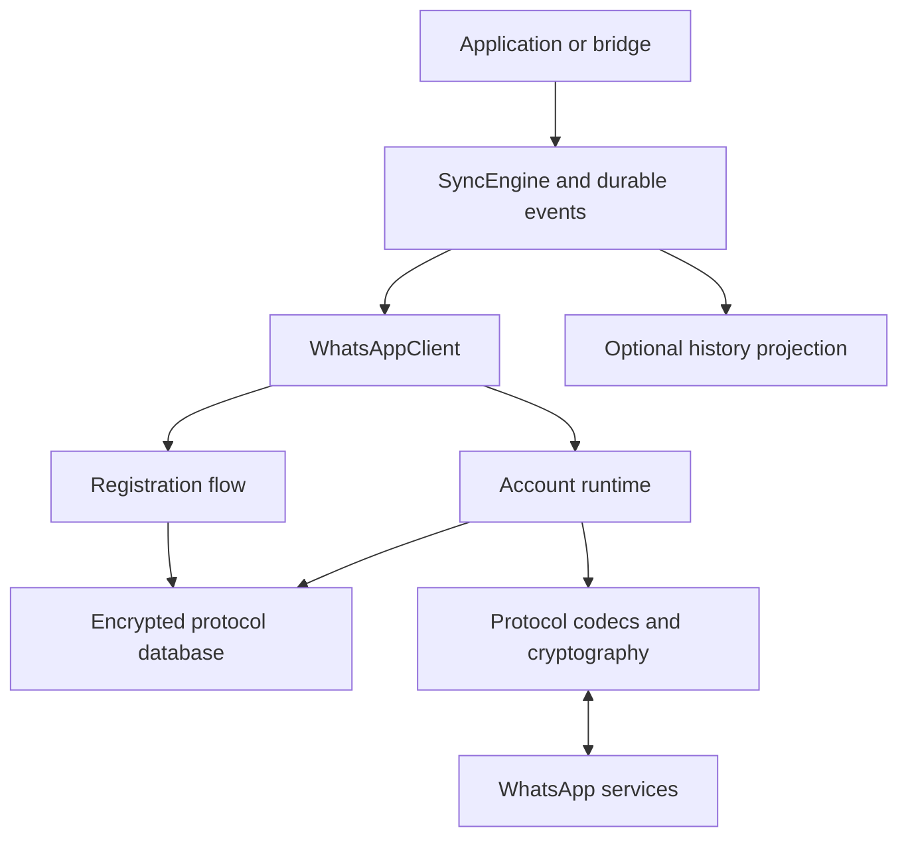

# Repository and runtime architecture

[Design index](README.md) · [Current status](../../STATUS.md)

Design requirements from the implementation plan revised 2026-09-17.
These describe intended behavior; see current status for implemented capabilities.
Original section numbers are retained for source and evidence references.

## 5. Repository layout

Keep one primary library crate. Split internal modules as they acquire real behavior; do not generate empty modules for every future feature.

| Path | Responsibility |
| --- | --- |
| `crates/whatsapp-api/Cargo.toml` | Library manifest and intentional feature selection |
| `src/lib.rs`, `src/client.rs`, `src/error.rs` | Public facade, lifecycle, typed errors |
| `src/model/` | Account/contact/device/chat identifiers, messages, receipts, capabilities |
| `src/profile.rs` | Validated protocol profile, reference version and compatibility information |
| `src/registration/` | Bootstrap state machine, HTTPS requests, challenges, durable attempt state |
| `src/transport/` | Byte-stream framing, Noise adapter, certificate verification, connection epochs |
| `src/binary/` | Nodes, bounded decoder/encoder, profile-specific tokens and JID encodings |
| `src/proto/`, `proto/` | Generated Rust and source schemas with provenance |
| `src/signal/` | Backend adapter, peer identities, sessions, prekeys, sender keys |
| `src/runtime/` | Account actor, stanza routing, bounded queues, request correlation, shutdown |
| `src/store/` | Transaction contract, `redb` backend, encrypted envelopes, migrations |
| `src/session.rs` | Credential lifecycle, key-source boundary, export/restore policy |
| `src/outbox.rs`, `src/inbox.rs` | Durable send attempts, inbound deduplication and processing |
| `src/sync.rs`, `src/reconcile.rs` | Durable events, local projections, observed catch-up behavior |
| `src/devices.rs`, `src/groups.rs`, `src/media.rs` | Feature-specific protocol operations |
| `tests/fixtures/`, `tests/` | Sanitized fixtures, negative cases, crash/replay/integration tests |
| `crates/whatsapp-cli/` | Rust operator tool, standalone proof client, and local HTTP control plane |
| `xtask/` | Rust schema generation, replay, dependency inspection and stress tools |
| `docs/protocol/`, `docs/adr/` | Evidence, unknowns, backend decisions and compatibility matrix |

The library must not depend on `crates/bridge` or `crates/tzibbur-api`. Inspect those crates for integration patterns; do not import application-specific errors, Telegram IDs, or session-file assumptions into the protocol library.

Use public library error names such as `Error` / `WhatsAppError`, not an application's `AppError`.

## 8. Runtime and protocol architecture



### 8.1 One owner per account

Start with one account actor owning mutable protocol state. Cloning `WhatsAppClient` clones a handle to that actor, not a connection or a second cryptographic session.

Use bounded command/event channels, an explicit cancellation token, and owned task handles. Separate socket I/O and blocking database work from the actor. No database guard or application mutex may remain held across unrelated network awaits.

Use a single process owner for each account database. Reject a second writer; do not build distributed leases or active-active session sharing for v0.1. Two machines with copied credentials must not be treated as supported concurrent owners.

Every connection has a new local epoch. Tag outstanding requests, reader/writer completions and reconnect tasks with it. A delayed response from an old socket must not complete a new request.

Implement bounded request correlation with expected response type, deadline, cancellation and disconnect behavior. Route unsolicited notifications separately from IQ/request responses.

### 8.2 Keep the layers separate

| Layer | Responsibility |
| --- | --- |
| Public domain API | Typed commands, status, capabilities and results |
| Behavior | Durable sends, device/group state, receipts, retries, media and reconciliation |
| E2EE and message models | Signal sessions/sender keys and the observed encrypted payload/wrapper formats |
| Binary nodes | Envelope descriptions, attributes, JIDs and child/content encoding |
| Transport security | Exact Noise handshake, certificate validation and record encryption |
| Framing and I/O | Observed preamble/length/compression rules and byte-stream boundaries |
| HTTPS operations | Registration and media/bootstrap operations that actually use HTTP |

Protobuf is used where the observed protocol uses it: potentially handshake payloads, certificates and encrypted message bodies. It is not a single mandatory wrapper around every operation. `WebMessageInfo` must not become the default Android wire payload merely because a reference library exposes it.

### 8.3 Noise is a compatibility decision

`Noise_XX_25519_AESGCM_SHA256` remains a hypothesis until confirmed for the profile. Noise does not inherently negotiate a cipher suite like TLS; do not describe a fixed observed suite as negotiated without evidence.

Verify pattern, prologue/preamble, payload placement, key roles, certificate encoding, trust roots, and the binding between the validated certificate and the remote static key. A successful Noise transcript alone does not validate an application-specific server certificate. Do not use an accept-all certificate callback.

Evaluate `snow` with its Rust crypto resolver. Its documented transport API rejects records exceeding 65,535 bytes, so verify observed WhatsApp record sizes before committing to it. Do not arbitrarily fragment WhatsApp records to fit a library; that would change the wire protocol. If needed, evaluate a reviewed existing Rust WhatsApp transport implementation or a narrowly justified backend change. [snow crypto documentation](https://docs.rs/snow/latest/snow/), [snow transport limits](https://docs.rs/snow/latest/snow/struct.TransportState.html)

Delegate AEAD/counter mechanics to the accepted transport backend. Maintain distinct send/receive state and ordered writes. After a partial write, ambiguous cancellation, authentication failure or socket loss, close that connection rather than guessing whether its counters can be reused. A reconnect performs a fresh handshake; never restore old Noise transport keys/counters to a new socket.

### 8.4 Framing and decoder boundaries

Read from a byte stream, not assumed packet boundaries. Handle fragmented headers/bodies and multiple frames in one read. Preserve partial bytes across cancellation, or tear down the entire connection on cancellation. A casual `select!` around a consuming `read_exact` is not a sufficient framing strategy.

Bound length prefixes before allocation. Bound decompressed output, nesting depth, attribute count, child count, strings, protobuf payloads and outstanding requests. Test decompression bombs and integer overflow.

An illustrative in-memory node shape is:

```rust
pub struct Node {
    pub description: NodeName,
    pub attributes: Vec<Attribute>,
    pub content: NodeContent,
}

pub enum NodeContent {
    Empty,
    Bytes(bytes::Bytes),
    Children(Vec<Node>),
}
```

This is a design sketch; `NodeName` and `Attribute` require concrete definitions. Preserve the original structure where useful, but support validated typed JIDs and any observed non-string encoding. Never decode malformed bytes through lossy UTF-8 conversion. Define duplicate-attribute handling explicitly, especially for security-sensitive fields.

Unknown *semantic* fields may be retained as opaque data. An unknown token that prevents structural decoding is a protocol-compatibility error, not an invitation to guess the remaining frame.
